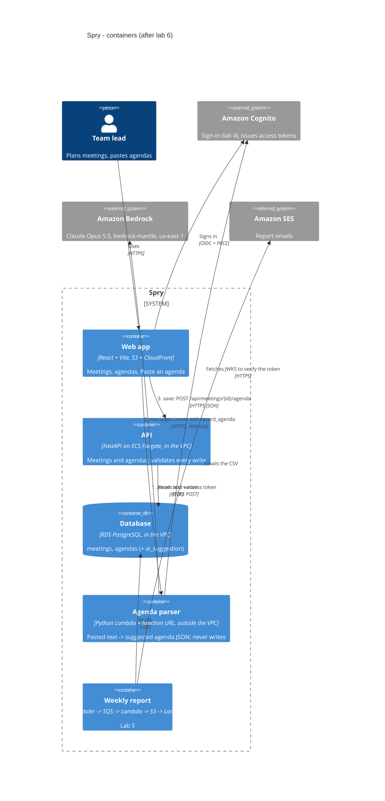

# Spry — containers (C4, level 2)

The Lab 1 container diagram, updated for lab 6. The new parts are the agenda parser and Amazon
Bedrock. There are two paths: **parse** (browser → parser → Bedrock) and **save** (browser → API
→ database).



Plain-text version:

```
                              +-------------------- AWS ---------------------------------+
team lead --HTTPS--> web app  |                                                          |
 (browser)  (S3+CloudFront)   |   outside the VPC                 us-east-1              |
     |                        |   agenda parser (Lambda URL) ---> Amazon Bedrock (Claude)|
     |--1. parse ------------>|        | JWKS                                            |
     |                        |        v                                                 |
     |                        |   Amazon Cognito                                         |
     |                        |                                                          |
     |                        |   VPC, no NAT                                            |
     |--3. save ------------->|   API (ECS Fargate) ---> RDS PostgreSQL                  |
                              |                          (meetings, agendas)             |
                              +----------------------------------------------------------+
```

Why the two paths differ is in [ADR 0006](adr/0006-llm-agenda-parsing.md).
